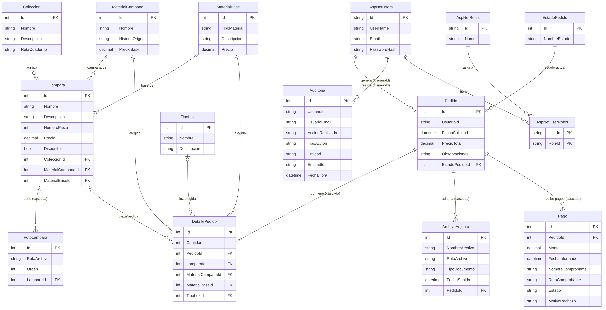

# Alma del Mar Pampeano

Aplicación web en **ASP.NET Core MVC (.NET 10)** para una marca de lámparas artesanales de roca, fósil y madera pampeana (La Pampa, Argentina). El visitante recorre el catálogo, el cliente pide una pieza terminada o diseña una lámpara a medida, informa su pago con un comprobante y sigue el estado del pedido. El administrador gestiona el catálogo, los pedidos, los pagos y los usuarios, y cuenta con un panel de estadísticas con un reporte redactado por IA.

> Trabajo Final Integrador — ASP.NET Core MVC.

**Sitio publicado:** https://almadelmarpampeano.runasp.net

> El sitio está en un plan de alojamiento gratuito: la primera visita después de un rato sin uso puede tardar unos segundos en cargar.

## Tecnologías
- ASP.NET Core MVC + Razor (.NET 10), Bootstrap 5, jQuery Validation, SweetAlert2
- Entity Framework Core (Code First, migraciones) sobre **SQL Server**
- ASP.NET Core Identity con roles (`Administrador`, `Cliente`)
- API de Google Gemini (asistente virtual y reporte para el administrador)

## Funcionalidades

### Para cualquier visitante
- **Inicio** con portada, colecciones, un adelanto de lámparas y los cuadernos de colección (PDF).
- **Página de lámparas** con todas las piezas, filtro por colección y fotos en carrusel.
- **Lumi**, el asistente virtual flotante: responde dudas sobre la marca, las colecciones, los precios y cómo pedir, usando los datos reales del catálogo.

### Para el cliente
- Registro e ingreso en español (quien se registra recibe el rol Cliente) y cambio de contraseña.
- **Pedir una pieza del catálogo** (viene definida: se confirma con notas opcionales) o **diseñar una lámpara a medida** eligiendo campana, base, tipo de luz y cantidad. Un pedido corresponde a una lámpara.
- **Reserva automática:** al pedir una pieza única, deja de estar disponible para los demás; si el pedido se cancela, vuelve a estarlo.
- "Mis pedidos" con barra de avance y un mensaje que explica qué pasa en cada estado.
- Editar las notas y **cancelar** el pedido mientras esté *Pendiente*.
- **Pago por transferencia:** ve el alias, el titular y la seña sugerida, e informa el pago subiendo el **comprobante**. Ve si fue confirmado o rechazado (con el motivo) y cuánto falta pagar.

### Para el administrador
- ABM de **lámparas** (con varias fotos), campanas, bases y estados de pedido.
- Ver todos los pedidos, filtrarlos por estado y **cambiar su estado**.
- **Revisar pagos:** ver el comprobante y confirmarlo o rechazarlo con un motivo. También puede registrar un pago recibido en mano.
- **Panel de estadísticas:** pedidos por estado, ventas estimadas, lo cobrado, pagos por revisar, colecciones y campanas más elegidas y actividad reciente, con filtro por período.
- **Reporte con IA:** un botón que genera un informe ejecutivo en lenguaje natural a partir de los números del panel.
- **Gestión de usuarios:** asignar una contraseña temporal a un cliente que la olvidó.
- **Auditoría:** consulta de todas las altas, modificaciones y bajas, con usuario y fecha.

## Roles
| Rol | Puede |
|---|---|
| Visitante | Ver el catálogo, las colecciones y los cuadernos; usar el chatbot |
| Cliente | Todo lo anterior + pedir, ver y cancelar **sus** pedidos, informar pagos, subir archivos, cambiar su contraseña |
| Administrador | Gestionar el catálogo, los pedidos y pagos de todos los clientes, los usuarios, el panel y la auditoría |

## Credenciales de prueba
| Rol | Usuario | Contraseña |
|---|---|---|
| Administrador | admin@almapampeana.com | Admin123! |
| Cliente | cliente@almapampeana.com | Cliente123! |

> Los datos para pagar que muestra el sitio (alias y titular) son **de prueba**.

## Seguridad y buenas prácticas
- **ViewModels** en los formularios principales: se reciben solo los campos permitidos (no hay *overposting*).
- **El precio lo calcula siempre el servidor**; nunca se toma del formulario. El monto de un pago se valida en formato argentino y no puede superar lo que falta pagar.
- Cada pedido se obtiene con un único punto de acceso que verifica el dueño: un cliente no puede ver ni modificar pedidos ajenos, ni siquiera cambiando la URL.
- Controladores de administración protegidos con `[Authorize(Roles = "Administrador")]`.
- Token antifalsificación (`[ValidateAntiForgeryToken]`) en todos los POST.
- Archivos subidos: extensión validada, tamaño máximo y nombre generado por el servidor (GUID).
- **Los comprobantes de pago no son públicos:** se guardan fuera de `wwwroot` y se entregan por una acción que verifica que quien los pide sea el dueño del pedido o el administrador.
- Claves foráneas `Restrict` en los datos del catálogo (no se puede borrar algo en uso, y la app lo explica) y `Cascade` en lo que pertenece a un pedido o a una lámpara.
- **Auditoría automática** en `SaveChangesAsync` de cada entidad relevante, incluidos los pagos.
- Límite de consultas por minuto al chatbot y al reporte de IA (*rate limiting*).
- A la IA solo se le envía información pública del catálogo y cifras agregadas: nunca correos ni datos de clientes.
- La clave de Gemini **no está en el repositorio** (ver más abajo).
- Páginas de error propias (404, 403) que conservan el código HTTP real.

## Cómo ejecutarlo en local
1. Requisitos: **.NET 10 SDK** y SQL Server (LocalDB alcanza).
2. Revisar la cadena `DefaultConnection` en `appsettings.json`.
3. Configurar la clave de Gemini (ver la sección siguiente).
4. Ejecutar `dotnet run`. Al iniciar, la app aplica las migraciones y crea los roles, los usuarios de prueba y los datos base.

### Configurar el chatbot (clave de Gemini)
La clave nunca se sube a GitHub. En desarrollo se guarda con *user-secrets*:

```bash
dotnet user-secrets set "Gemini:ApiKey" "TU_CLAVE"
```

En el servidor, la clave va en un archivo `appsettings.Production.json` que **no está versionado**. Los nombres de los modelos se configuran en `appsettings.json` (`Gemini:Model` y `Gemini:ModelosAlternativos`); si el modelo principal falla, el servicio reintenta con los alternativos.

### Otros ajustes en `appsettings.json`
- `Pago`: `Alias`, `Titular` y `PorcentajeSena` (porcentaje sugerido como seña). Hoy tienen valores de prueba.
- `Contacto`: `Instagram`, `WhatsApp`, `Correo` y `Ciudad`. Los que están vacíos no se muestran en el pie de página.

## Modelo de datos
12 tablas propias, además de las de Identity: `Coleccion`, `Lampara`, `FotoLampara`, `MaterialCampana`, `MaterialBase`, `TipoLuz`, `EstadoPedido`, `Pedido`, `DetallePedido`, `ArchivoAdjunto`, `Pago` y `Auditoria`.

Un `Pedido` pertenece a un usuario y tiene un estado. Su `DetallePedido` indica la campana, la base y el tipo de luz, y apunta a la `Lampara` del catálogo cuando se pidió una pieza terminada (queda vacío en las lámparas a medida). Cada `Pago` informado cuelga del pedido y guarda su comprobante y su estado (pendiente de revisión, confirmado o rechazado).



## Estructura
- `Models/` entidades de la base de datos
- `ViewModels/` modelos de entrada y de vista
- `Controllers/` lógica MVC (catálogo, pedidos y pagos, panel, chat, administración)
- `Services/` integración con Gemini
- `Data/` `ApplicationDbContext` (con la auditoría automática) y `DbInitializer`
- `Areas/Identity/` pantallas de ingreso y registro
- `Migrations/` migraciones de EF Core
- `wwwroot/` estilos, scripts, imágenes y archivos subidos

## Próximos pasos
- Cobro con Mercado Pago.
- Avisos por correo cuando cambia el estado del pedido.
- Pruebas automáticas y pipeline de integración continua.